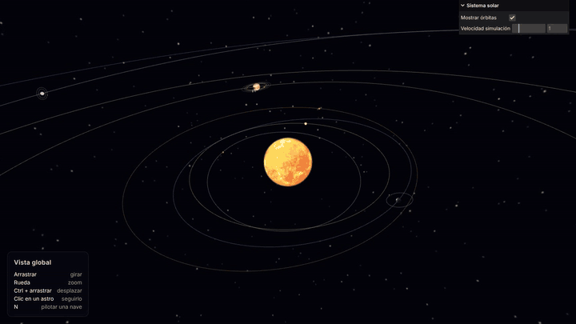
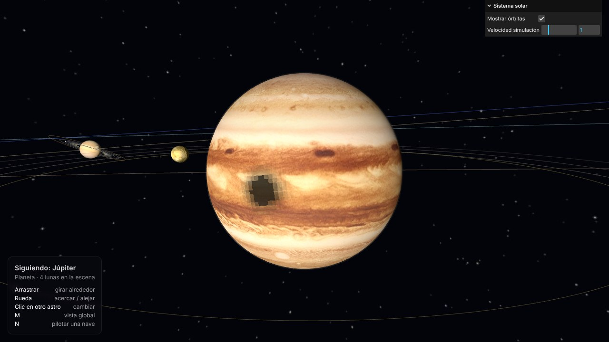
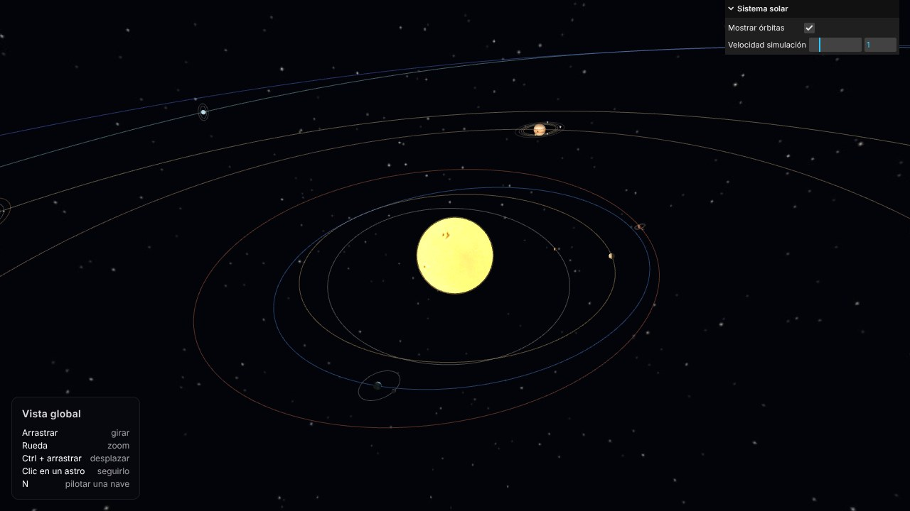
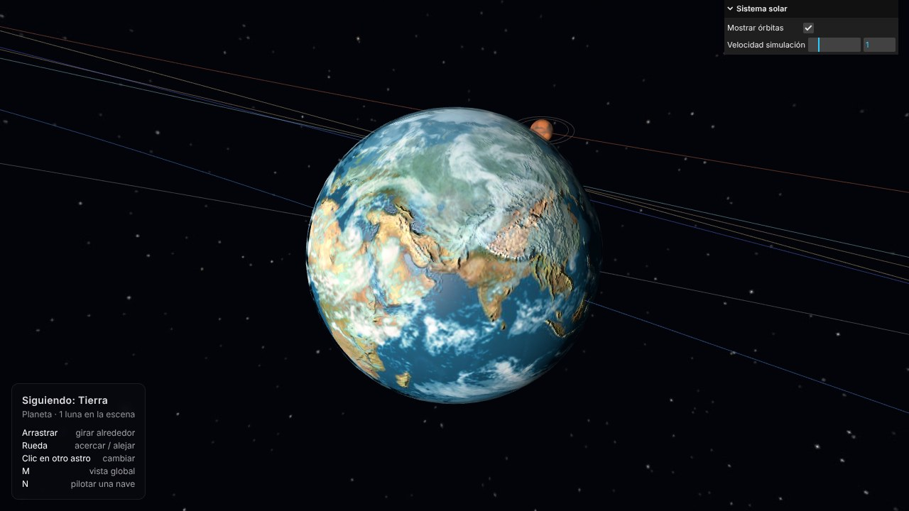
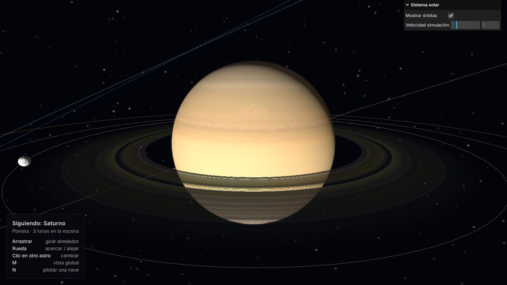
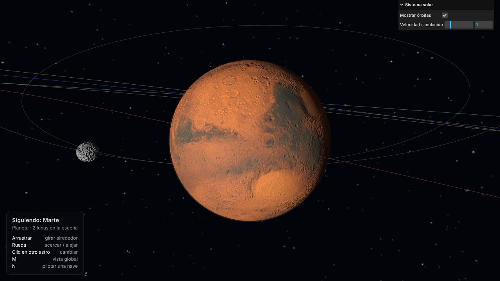
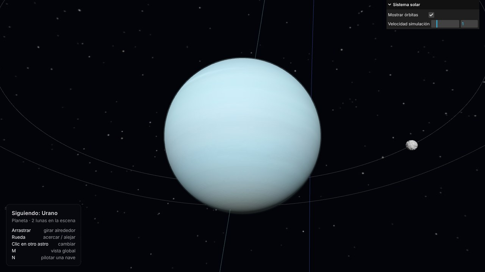
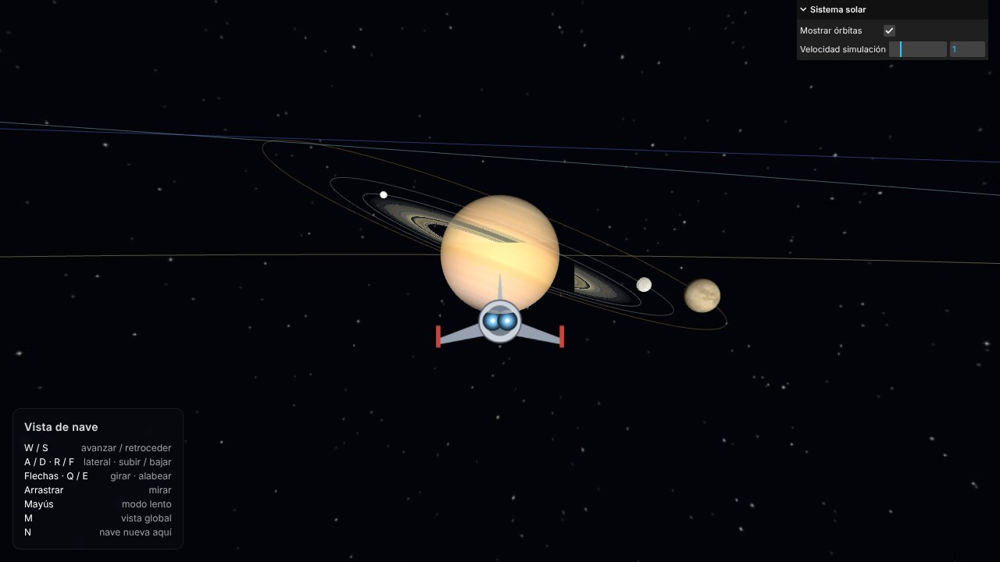

# Práctica sistema solar

Sistema solar interactivo hecho con [three.js](https://threejs.org/) (r152). Incluye el Sol, los ocho planetas y 13 lunas, cada uno con su órbita elíptica e inclinada, su rotación propia, la inclinación de su eje, una textura de superficie con relieve y una capa atmosférica con transparencia. Se puede recorrer con tres vistas: una general, una que sigue a cualquier astro y una nave que se pilota en tercera persona.

### Autor:
- [Sergio Rodríguez Rubio](https://github.com/SergioRodriguezEnt)

**Proyecto en CodeSandbox:** [https://codesandbox.io/p/sandbox/ig-s7-forked-582rnc](https://codesandbox.io/p/sandbox/ig-s7-forked-582rnc)

**Vídeo de la ejecución:** [https://youtu.be/DK5pmQmJ8Z8](https://youtu.be/DK5pmQmJ8Z8)



------

## Estructura de la carpeta

```
/
|- src/                      #Código
|  |- index.html             #Página: lienzo, panel de ayuda y etiqueta de nombres
|  |- main.js                #Escena, renderer, cambio de vistas, eventos y bucle
|  |- Astro.js               #Clase Astro: estrella, planeta o luna
|  |- datos.js               #Datos reales de cada astro y conversión a parámetros visuales
|  |- escala.js              #Funciones de compresión de distancias, tamaños y periodos
|  |- texturas.js            #Carga de texturas (con caché y espacio de color)
|  |- rutasTexturas.js       #Importación de todas las imágenes de res/
|  |- interfaz.js            #GUI (lil-gui), panel de ayuda y etiqueta flotante
|  |- seleccion.js           #Selección de astros con el ratón (Raycaster)
|  |- sombras.js             #Sombras y eclipses calculados en el shader
|  |- vistas/
|     |- VistaGlobal.js      #Vista orbital general (OrbitControls)
|     |- VistaAstro.js       #Vista orbital sobre un astro, tipo satélite geoestacionario
|     |- VistaNave.js        #Vista de nave en tercera persona (FlyControls)
|- res/                      #Texturas
|  |- <astro>/               #Una carpeta por astro: sol, mercurio, ..., triton
|  |  |- color.jpg           #Textura básica
|  |  |- relieve.jpg         #Heightmap (bumpMap)
|  |  |- atmosfera.jpg       #Textura atmosférica
|  |  |- atmosfera_alfa.jpg  #Mapa de transparencia de la atmósfera
|  |- tierra/especular.jpg   #Mapa especular de la Tierra (brillo de los océanos)
|  |- saturno/anillo_color.jpg, anillo_alfa.png  #Color y transparencia de los anillos
|  |- fondo.jpg              #Fondo del espacio (equirectangular)
|  |- nave.png               #Sprite de la nave
|- readme-data/              #Capturas y vídeos del README
|- package.json
|- README.md
```

## Recursos necesarios

El proyecto está pensado para CodeSandbox, que instala las dependencias de `package.json`:

- `three` 0.152.1
- `lil-gui` ^0.19.0
- `parcel-bundler` ^1.6.1 (desarrollo)

Para ejecutarlo en local: `npm install` y `npm start`. Las texturas se importan desde el código (`import tex from "../res/..."`), así que Parcel las incluye en el paquete aunque estén fuera de `src/`.

------

## Controles

La interfaz se explica sola: abajo a la izquierda hay un panel que cambia con cada vista y muestra los controles disponibles, y al pasar el ratón sobre un astro aparece su nombre.

| Vista | Control | Acción |
|---|---|---|
| **Global** | Arrastrar | Girar alrededor del punto de atención |
| | Rueda | Zoom |
| | `Ctrl` + arrastrar | Desplazar la cámara |
| | Clic en un astro | Pasar a la vista de ese astro |
| **Astro** | Arrastrar | Cambiar el punto de órbita |
| | Rueda | Acercar / alejar |
| | Clic en otro astro | Seguir a ese astro |
| **Nave** | `W` / `S` | Avanzar / retroceder |
| | `A` / `D` · `R` / `F` | Moverse a los lados · subir / bajar |
| | Flechas · `Q` / `E` | Girar · alabear |
| | Arrastrar | Mirar |
| | `Mayús` | Modo lento |
| **Todas** | `N` | Crear una nave en la posición de la cámara y pilotarla |
| | `M` | Volver a la vista global desde la posición actual de la cámara |

La GUI de la esquina superior derecha permite **mostrar u ocultar las órbitas** y cambiar la **velocidad de la simulación** (de 0, pausa, a ×5).

------

## Descripción del trabajo

### Árbol de astros

Todos los astros son objetos de una misma clase, `Astro`, y forman un árbol que reproduce la jerarquía física: los planetas cuelgan del Sol y las lunas de su planeta. Cada astro se compone de varios nodos del grafo de escena:

```
padre
└─ planoOrbital    orientado según el nodo ascendente, la inclinación y el periapsis
   ├─ lineaOrbita  elipse con el padre en uno de sus focos
   └─ centro       se traslada por la elipse (no gira)
      ├─ luz       solo en el Sol
      └─ eje       inclinación del eje de rotación (no gira)
         ├─ cuerpo      superficie: textura + heightmap; gira sobre sí mismo
         ├─ atmosfera   capa exterior con mapa de transparencia; gira a su ritmo
         ├─ anillo      solo en Saturno
         └─ hijos       planos orbitales de sus lunas
```

Separar la traslación (`centro`) de la rotación propia (`cuerpo`) evita el problema visto en la sesión 6 con `PlanetaChild`, donde el hijo giraba solidario con la rotación de su padre, como un satélite geoestacionario. Aquí las lunas siguen el movimiento orbital del planeta, pero no su giro. Como cuelgan del `eje`, orbitan sobre el ecuador de su planeta: las de Urano dan vueltas casi en vertical, igual que en la realidad. La Luna es la excepción, porque su órbita sigue la eclíptica y no el ecuador terrestre.

Todos los astros tienen órbita. La del Sol es nula: no tiene `orbita`, así que no se mueve ni dibuja elipse.

### Órbitas y rotación

- **Órbitas elípticas**: la posición se calcula resolviendo la ecuación de Kepler (`M = E − e·sin E`) con Newton-Raphson. Así el astro va más rápido cerca del periapsis, como manda la segunda ley de Kepler. La línea de la órbita se construye con los mismos parámetros, así que coincide exactamente con la trayectoria.
- **Inclinación**: el `planoOrbital` se orienta con tres rotaciones (nodo ascendente, inclinación y argumento del periapsis), los elementos orbitales reales J2000.
- **Rotación propia**: cada `cuerpo` gira según su periodo sideral. La inclinación del eje (23,4º la Tierra, 97,8º Urano) va en el nodo `eje`. Venus (177º) y Urano giran al revés que el resto.
- **Rotación síncrona**: las lunas muestran siempre la misma cara a su planeta, porque su giro se calcula a partir de su posición en la órbita.
- **Tritón** tiene una órbita retrógrada (157º): gira al revés que Neptuno.

### Escalas

Con las distancias y tamaños reales los planetas serían invisibles, así que se comprimen con funciones potencia (`escala.js`). Estas funciones conservan el orden real: lo grande sigue siendo más grande y lo lejano, más lejano. Los datos de `datos.js` son los reales (km, UA, días), y la conversión se hace al crear cada astro.

| Magnitud | Fórmula | Ejemplo |
|---|---|---|
| Radio | `2 · (R / R_Tierra)^0.55`, mínimo 0,22 | Tierra 2, Júpiter 7,5, Sol 26 |
| Distancia al Sol | `40 + 85 · UA^0.75` | Mercurio 82, Tierra 125, Neptuno 1131 |
| Distancia de una luna | `R_planeta · (1,4 + 0,5 · √(a / R_planeta_real))` | Mantiene la forma de cada sistema |
| Periodo orbital | `20 · (T / 1 año)^0.35` | Un año dura 20 unidades de tiempo; Neptuno, 119 |
| Periodo de rotación | `10 · (T / 1 día)^0.5` | Un día terrestre dura 10 unidades |
| Excentricidad | `e · 1,6` (máximo 0,22) | Exagerada un poco para que se aprecie |
| Inclinación | `i · 1,5` | Ídem |

El tiempo de simulación avanza a `velocidad · FACTOR_TIEMPO_SIMULACION` (0,1) unidades por segundo, así que a velocidad ×1 un año terrestre dura 200 s y un día, 100 s.

### Texturas

Cada astro tiene cuatro mapas en su carpeta de `res/`, que se aplican con `MeshPhongMaterial`:

- **Textura básica** (`map`) con su **heightmap** (`bumpMap`). El relieve no deforma la geometría: solo cambia la iluminación, así que se nota sobre todo junto al terminador.
- **Textura atmosférica** (`map`) con su **mapa de transparencia** (`alphaMap`, blanco = opaco) en una segunda esfera un poco mayor (1–5 % más), que gira a su propio ritmo. La atmósfera de Venus gira 60 veces más rápido que el planeta (superrotación).

Según el astro, la capa atmosférica representa cosas distintas:

| Astro | Capa atmosférica |
|---|---|
| Sol | Corona con mezcla aditiva |
| Venus | Nubes densas que tapan casi toda la superficie |
| Tierra | Nubes (los mapas de la sesión 7) |
| Marte | Polvo tenue |
| Gigantes gaseosos | Bruma en bandas |
| Titán | Bruma anaranjada espesa |
| Tritón | Bruma muy tenue |
| Resto (Mercurio y lunas) | Mapa de transparencia en negro: capa totalmente transparente |

Además, la Tierra tiene un **mapa especular** para que solo brillen los océanos, y Saturno tiene **anillos**: un `RingGeometry` cuyas coordenadas UV se recalculan para que la textura (una franja) recorra el radio.

El **fondo** es `scene.background` con una imagen equirectangular de estrellas generada a propósito, minimalista y sin nebulosas.

### Iluminación y sombras

- El Sol lleva una `PointLight` sin atenuación (`decay = 0`), así que ilumina igual a todo el sistema. Su superficie usa un material emisivo, ya que la luz está dentro de él.
- Una luz ambiente muy débil deja ver un poco las caras nocturnas.
- **Sombras y eclipses**: se calculan en el shader (`sombras.js`), sin mapa de sombras. Al principio se usó `renderer.shadowMap` con la `PointLight`, pero su mapa cúbico tiene que cubrir todo el sistema y los eclipses salían muy pixelados.
  - Cada superficie conoce las esferas que pueden taparle el Sol (sus *ocultadores*). Vistos desde un punto, el Sol y el ocultador son dos círculos en el cielo, y la luz que llega es la parte del disco solar que no queda tapada (área de solape de dos círculos). Así salen solas la **umbra** y la **penumbra**, con bordes nítidos a cualquier distancia.
  - El código se inyecta en `MeshPhongMaterial` con `onBeforeCompile`: se multiplica la luz del Sol por la fracción visible.
  - Ocultadores: un planeta recibe la sombra de sus lunas; una luna, la de su planeta y la de las otras lunas (**eclipses de Luna**); los anillos de Saturno, la del planeta y sus lunas. Además, el anillo hace sombra sobre Saturno: se busca dónde corta el rayo hacia el Sol el plano del anillo y se consulta su mapa de transparencia.
  - Solo cuentan los astros del mismo sistema: con la escala comprimida, un planeta interior alineado con uno exterior lo dejaría a oscuras, algo imposible en la realidad.
  - Para el tamaño del Sol se usa su tamaño aparente real desde la distancia real del planeta (×4 para que la penumbra se aprecie). En la escena el Sol se ve mucho más grande y los eclipses se quedarían en una penumbra tenue.

| Eclipse de Ganímedes sobre Júpiter | Eclipse de Luna (entrando en la sombra de la Tierra) |
|---|---|
|  |  |

### Vistas

| Vista | Cámara | Cómo se activa |
|---|---|---|
| **Global** | `PerspectiveCamera` + `OrbitControls`. Se empieza aquí, mirando al Sol | Tecla `M`: la cámara se queda donde estaba y el punto de giro pasa a ser el astro que se seguía (o un punto 40 unidades por delante de la nave) |
| **Astro** | La misma cámara, colocada en coordenadas esféricas en el sistema de referencia del `cuerpo` del astro. Gira con él como un satélite geoestacionario; el ratón cambia los ángulos y la rueda la distancia | Clic sobre cualquier astro (Sol, planeta o luna), desde la vista global o desde la de otro astro. La cámara se acerca suavemente conservando la dirección desde la que se miraba |
| **Nave** | Otra `PerspectiveCamera`, hija de la nave, detrás de ella (tercera persona). `FlyControls` mueve la nave | Tecla `N`: se crea la nave en la posición y orientación actuales de la cámara. Al salir, la nave se queda en la escena; al volver a pulsar `N`, se borra y se crea una nueva |

Para seleccionar con el ratón se usa un `Raycaster` contra las superficies. Si el rayo no toca ninguna, se elige el astro más cercano en pantalla (a menos de 12 píxeles de su disco), para poder hacer clic en lunas que ocupan muy poco. Un arrastre no cuenta como clic.

### Capturas

| | |
|---|---|
|  |  |
|  |  |
|  |  |

**Problemas observados y limitaciones:**
- Con el mapa de sombras de la `PointLight` los eclipses salían pixelados, los anillos proyectaban una sombra escalonada y las atmósferas se oscurecían solas. Se resolvió calculando las sombras en el shader.
- Las sombras solo se calculan entre astros del mismo sistema planetario.
- Como las lunas están mucho más cerca de su planeta que en la realidad, sus sombras son proporcionalmente más grandes.
- El sprite de la nave tapaba las atmósferas que tenía detrás (escribía profundidad en todo su cuadrado). Se arregló con `alphaTest`, `depthWrite: false` y dibujándolo el último.
- Fobos y Deimos son irregulares, pero aquí son esferas.

------

## Fuentes

### Texturas

Las texturas se han tomado de repositorios públicos o se han generado. En la tabla, **generada** quiere decir que se ha creado con un script de Python a partir de otra textura (relieve = luminancia suavizada) o con ruido procedural (atmósferas, fondo, nave).

| Astro | Textura básica | Heightmap | Atmósfera y transparencia |
|---|---|---|---|
| Sol | [Solar System Scope](https://www.solarsystemscope.com/textures/) (CC BY 4.0) | generada (a partir de la textura de PPE) | generadas (corona) |
| Mercurio | PPE | PPE | transparente |
| Venus | NASA 3D Resources (Magellan) vía SolSisSim | generada | generadas (nubes) |
| Tierra | PPE | PPE | PPE (nubes, sesión 7) |
| Luna | PPE | PPE | transparente |
| Marte | PPE | PPE | generadas (polvo) |
| Júpiter, Saturno, Urano, Neptuno | PPE | generada | generadas (bruma) |
| Anillos de Saturno | PPE | – | PPE |
| Fobos, Deimos, Ío, Europa, Ganímedes, Calisto | NASA 3D Resources vía SolSisSim | generada | transparente |
| Titán | Steve Albers (Cassini) vía SolSisSim | generada | CelestiaContent (bruma) + transparencia generada |
| Encélado, Rea | CelestiaContent (Paul Schenk, NASA) | generada | transparente |
| Titania, Miranda, Tritón | CelestiaContent (Voyager 2) vía SolSisSim | generada | transparente (Tritón: bruma generada) |

- **PPE**: [Planet Pixel Emporium](http://planetpixelemporium.com/planets.html) (James Hastings-Trew), obtenidas del repositorio [threex.planets](https://github.com/jeromeetienne/threex.planets/tree/master/images).
- **SolSisSim**: [MTE1991/SolSisSim](https://github.com/MTE1991/SolSisSim/tree/main/public/textures), que recopila mapas de [NASA 3D Resources](https://github.com/nasa/NASA-3D-Resources) (dominio público) y de CelestiaContent.
- **CelestiaContent**: [CelestiaProject/CelestiaContent](https://github.com/CelestiaProject/CelestiaContent/tree/master/textures/hires) (licencias CC BY / CC BY-SA, ver el repositorio).

**Fuentes alternativas con más calidad**, para sustituir las texturas generadas (basta con reemplazar el archivo en `res/<astro>/` manteniendo el nombre):

- [Solar System Scope](https://www.solarsystemscope.com/textures/) (CC BY 4.0): Sol, planetas, Luna, nubes de la Tierra, **atmósfera de Venus**, anillos de Saturno con transparencia y fondo de estrellas.
- [NASA 3D Resources](https://github.com/nasa/NASA-3D-Resources): mapas de dominio público de varias lunas.
- [USGS Astrogeology](https://astrogeology.usgs.gov/): modelos de elevación reales, para heightmaps de la Luna, Marte, Mercurio y algunas lunas.

### Datos y documentación

- [Guía de la sesión 6](https://github.com/otsedom/otsedom.github.io/tree/main/IG/S6) y [guía de la sesión 7](https://github.com/otsedom/otsedom.github.io/tree/main/IG/S7)
- [Documentación de three.js](https://threejs.org/docs/): `OrbitControls`, `FlyControls`, `MeshPhongMaterial` (`onBeforeCompile`), `ShaderChunk`, `RingGeometry`, `Sprite`, `Raycaster`
- [NASA/JPL – Elementos orbitales aproximados de los planetas](https://ssd.jpl.nasa.gov/planets/approx_pos.html)
- [NASA/JPL – Parámetros de los satélites](https://ssd.jpl.nasa.gov/sats/elem/)
- [NASA – Fichas de los planetas](https://nssdc.gsfc.nasa.gov/planetary/factsheet/)
- [lil-gui](https://lil-gui.georgealways.com/)

### Asistencia de IA

- [Generación del módulo de datos de los astros, `datos.js` (chat con Claude)](https://claude.ai/share/a6933601-6dd5-422b-81df-d3136f32fd29)
- [Corrección de los anillos de Saturno (chat con Claude)](https://claude.ai/share/4aced515-45bb-4b9d-af06-8f9dcee8f8f9)
- [Selección de astros con el ratón y vista orbital sobre un astro (chat con Claude)](https://claude.ai/share/abd2e374-fb51-40bc-b593-882b8ce61c75)